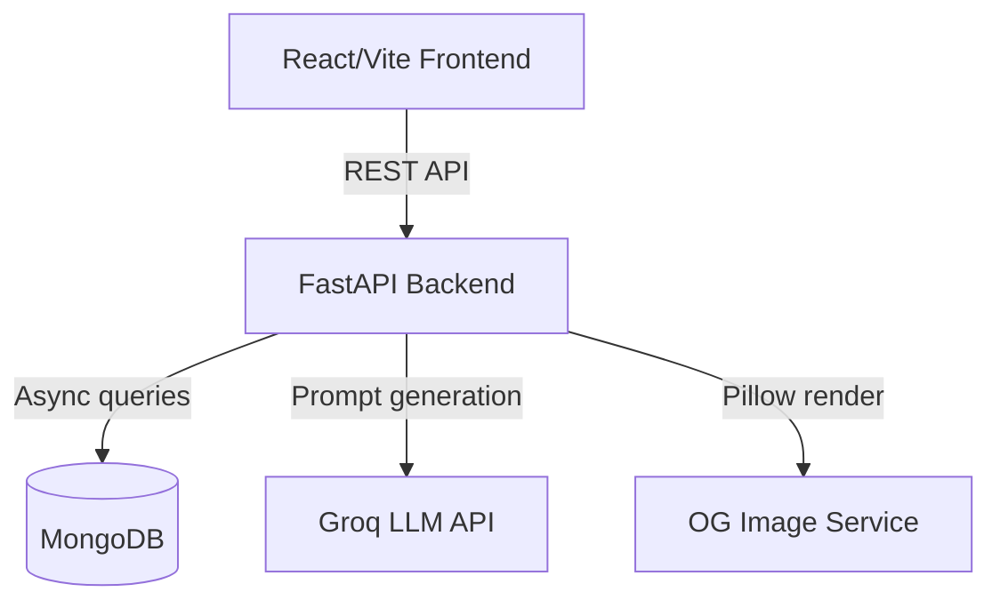

# TypeForge ⌨️🔥

**TypeForge** is an AI-powered typing platform designed to help you learn Computer Science concepts at the speed of light. It replaces generic typing tests with highly curated, dynamically generated passages about programming, data structures, and computer science domains.

 <!-- Replace with an actual screenshot later -->

## ✨ Features

- **AI-Curated Content**: Passages are generated on-the-fly using the Groq LLM API, ensuring you never type the same passage twice.
- **Dynamic Difficulty**: Choose your domain (e.g., Programming, DBMS, OS) and difficulty level.
- **Advanced Analytics**: Track WPM, accuracy, and keystroke metrics with detailed MongoDB aggregation pipelines.
- **Concept Summaries**: After typing, get a concise reinforcement summary of the CS concept you just typed.
- **Mistake Analysis**: AI identifies which letters and words you struggle with.
- **Terminal Luxury Aesthetic**: A beautiful, distraction-free UI featuring `IBM Plex Mono` and high-contrast dark mode.
- **Shareable Results**: Generate beautiful, Pillow-rendered OG images of your typing sessions.

## 🏗️ Architecture

- **Frontend**: React 19, Vite, Tailwind CSS, Recharts.
- **Backend**: FastAPI (Python), Motor (async MongoDB), SlowAPI (Rate Limiting).
- **Database**: MongoDB 6.0
- **AI**: Groq API (Llama3-8b-8192)



## 🚀 Getting Started (Docker)

The absolute fastest way to get TypeForge running locally is using Docker Compose.

### Prerequisites
- Docker & Docker Compose
- A [Groq API Key](https://console.groq.com/)

### Setup

1. Clone the repository:
   ```bash
   git clone https://github.com/yourusername/typeforge.git
   cd typeforge
   ```

2. Configure environment variables:
   ```bash
   cp .env.example .env
   ```
   Open `.env` and add your `GROQ_API_KEY`. Be sure to change your `JWT_SECRET` and `ADMIN_PASSWORD` as well.

3. Spin up the stack:
   ```bash
   docker-compose up --build -d
   ```

4. Access the app:
   - Frontend: http://localhost:3000
   - Backend API Docs: http://localhost:8000/docs
   - Login with the Admin credentials you set in your `.env` file.

## 🛠️ Local Development (Without Docker)

### Backend Setup
```bash
cd backend
python -m venv venv
source venv/bin/activate
pip install -r requirements.txt
# Ensure MongoDB is running locally
uvicorn server:app --reload --port 8000
```

### Frontend Setup
```bash
cd frontend
npm install
npm run dev
```

## 🤝 Contributing
Contributions are always welcome! Please follow these steps:
1. Fork the project.
2. Create a Feature Branch (`git checkout -b feature/AmazingFeature`).
3. Commit your changes (`git commit -m 'Add some AmazingFeature'`).
4. Push to the Branch (`git push origin feature/AmazingFeature`).
5. Open a Pull Request.

## 📄 License
This project is open-source and available under the MIT License.
